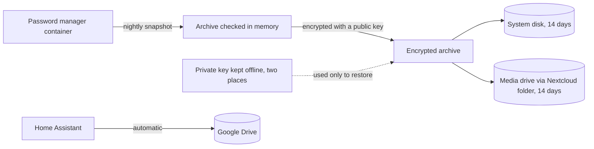

# Scope and asset inventory

## Purpose and boundary

This assessment covers a household home lab that runs family services: a password manager, photos, files, smart home control, DNS filtering, and media. The lab is run by one administrator for a small household.

A "customer" here is the household. The main things to protect are the family's irreplaceable data (photos and documents), the password vault, and the services the household relies on every day.

## In scope

- The lab server and the services running on it, in containers and in one virtual machine
- The home network equipment that connects them
- Remote access through the private network and the home automation cloud relay
- Backups of the above
- The two machines the administrator uses to manage the server

## Out of scope

- Physical security of the home
- The internet provider
- Smart home devices themselves, other than as a risk to the network
- Household members' personal phones and computers
- The internals of cloud providers

## Asset inventory

Criticality: **High** means loss or compromise would seriously harm the household, because the data is irreplaceable, it holds credentials, or the household depends on the service every day. **Medium** means a noticeable loss with a workaround. **Low** means a convenience.

| ID | Asset | Type | Role | Criticality | Data | Access path |
| --- | --- | --- | --- | --- | --- | --- |
| A-01 | Lab server | Repurposed laptop | Runs every service below, except the router and switch | High | D-01 to D-08 | Key-only SSH |
| A-02 | Home Assistant | Virtual machine | Smart home automation | Medium | D-05 | Local network name, and a cloud relay for the phone app |
| A-03 | Pi-hole and Unbound | Host service | DNS filtering and recursive resolver for the whole household | High | D-08 | LAN DNS |
| A-04 | Tailscale | Host service | Remote access, subnet router, exit node | High | None stored | Private network |
| A-05 | Nginx Proxy Manager | Container | Reverse proxy for local names | Medium | D-07 | LAN |
| A-06 | Vaultwarden | Container | Password manager | High | D-01 | Private network over HTTPS |
| A-07 | Nextcloud with its database and cache | Containers | File sync and storage | High | D-03 | Private network over HTTPS |
| A-08 | Immich | Container | Photo library | High | D-02 | Local name, and the private network |
| A-09 | Actual Budget | Container | Household budgeting | High | D-04 | Private network over HTTPS |
| A-10 | Jellyfin | Container | Media streaming | Low | D-06 | Local name, and the private network |
| A-11 | Mealie | Container | Recipes and meal plans | Low | None sensitive | Local name |
| A-12 | Uptime Kuma and a filtering proxy | Containers | Availability monitoring | Medium | D-07 | Local name |
| A-13 | Netdata | Container | Host metrics | Low | D-07 | Local name |
| A-14 | MySpeed | Container | Internet speed tests | Low | None sensitive | Local name |
| A-15 | Homepage | Container | Dashboard for the whole lab | Low | D-07 | Local name |
| A-16 | File sharing service | Service | Moves large files from the desktop to the media drive | Medium | D-06 | LAN |
| A-17 | Mesh router | Network | Gateway and DHCP, hands out the DNS server | High | None stored | LAN, and the vendor app |
| A-18 | Managed switch | Network | Wired connectivity | Medium | None stored | LAN |
| A-19 | Raspberry Pi 4 | Spare hardware | Planned second DNS node. Offline | Low | None | Not connected |
| A-20 | External media drive | Storage | Holds media, photos, and Nextcloud files | High | D-02, D-03, D-06 | Attached to A-01 |
| A-21 | Administrator desktop | Endpoint | Manages the server. Syncs a folder to Nextcloud | Medium | Copies of D-03 | Key-based SSH |
| A-22 | Administrator laptop | Endpoint | Manages the server | Medium | None stored | Key-based SSH |

Detail on how each service is set up is in [homelab-docs](https://github.com/tbrown70128/homelab-docs/blob/main/docs/architecture.md).

## Data inventory

| ID | Data | Classification | Where it lives | Protection today |
| --- | --- | --- | --- | --- |
| D-01 | Password vault | Restricted | Vaultwarden on the server | Encrypted by the application. Nightly backup, encrypted, on two disks in the same machine |
| D-02 | Family photos | Confidential, irreplaceable | Media drive | Single copy |
| D-03 | Documents and synced files | Confidential, irreplaceable | Media drive | Single copy on the server. Part of it also lives on the synced desktop folder |
| D-04 | Budget and financial data | Restricted | Lab server | Served over HTTPS on the private network |
| D-05 | Home automation configuration and history | Internal | Home Assistant virtual machine | Automatic backup to cloud storage |
| D-06 | Media library | Low, replaceable | Media drive | None needed |
| D-07 | Service configuration | Internal | Lab server, with reference copies in the public docs repo | Compose files, with secrets kept out of version control |
| D-08 | DNS query logs | Confidential, shows household browsing | Pi-hole | Local to the server |

Classification: **Restricted** (credentials or financial data), **Confidential** (private to the household), **Internal** (operational), **Low** (public or replaceable).

## Outside suppliers

| Supplier | What it provides | If it fails |
| --- | --- | --- |
| Tailscale | Private network and its coordination service | No remote access. Local access still works |
| Home Assistant cloud relay | Remote access for the phone app | No remote app access. Local access still works |
| Google Drive | Home Assistant backups | Backups pause until it returns |
| Container registries | Source of service images | Updates cannot be pulled. Running services are unaffected |
| Internet provider | Internet access | Local services work. Remote access and updates stop |

## Backup data flow

Photos, files, and media have no backup copy yet. That is the largest open risk. See finding F-09 in the [plan of action](04-poam.md).

## Assumptions

- The home network is reachable by guests and smart home devices, so the LAN is treated as untrusted.
- No router port forwards are open. Remote access goes only through the private network and the home automation relay.
- One person administers everything, so there is no separation of duties.
